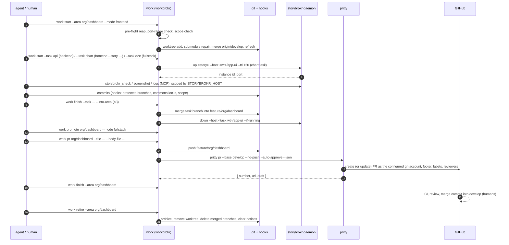

# The life of a worktree: one feature, three tasks, through `work`, storybrokr and pritty

**Date:** 2026-10-19 · **Versions:** workbrokr 0.3.1, storybrokr 0.3.1, pritty 0.2.0 · **Example project:** skoolscout-com (manifest `helmsmith.config.ts`, base branch `develop`, Storybook host `app-ui`) · **Specs:** `superpowers/specs/2026-10-17-workbrokr-design.md` (incl. §18 Amendment A), `2026-10-18-workbrokr-parallel-waves-design.md`, `2026-10-18-storybrokr-worktree-isolation-design.md`

This is the whole arc for one feature with three tasks: a new "applicant hometowns" chart on the `org/dashboard` area, made of a backend endpoint, a frontend component and an end-to-end check. Every command below is one the tools have today.

---

## 1. The shape

```
 main checkout (develop, slot 0 = the human's)   registry ~/.work/registry.json
 ──────────────────────────────────────────────   ───────────────────────────────
                                                  efforts · leases · notices
   .claude/worktrees/
   ├── org/dashboard                 ← area effort    branch feature/org/dashboard
   └── _tasks/
       ├── org/dashboard--api        ← task effort    branch feature/org/dashboard--api    (backend, slot N)
       ├── org/dashboard--chart      ← task effort    branch feature/org/dashboard--chart  (frontend, storybrokr instance)
       └── org/dashboard--e2e        ← task effort    branch feature/org/dashboard--e2e    (fullstack, slot M)

 storybrokr daemon ~/.storybrokr      pritty (.pritty.json in the repo)
 ───────────────────────────────      ────────────────────────────────
 one Storybook per worktree host      push + PR mechanics, attribution
```

Every branch is `<type>/<area>` or `<type>/<area>--<task>`. Every worktree is synced from `origin/develop` by merge, never rebase. Leases, not conventions, decide who holds a slot, a Storybook or a commons write lock.



---

## 2. The sequence

### 0. Pre-flight, before anything is created

`work start` reaps first: expired leases are released and starts that died before their first lease are parked, so abandoned efforts cannot hold the slots. It fetches `origin/develop`, refuses if another open effort owns the area (unless `--join`), refuses if the requested scope overlaps an open effort's scope, re-checks the project's port ranges against other projects on the machine, and gates on `storybrokr` 0.3.0 or newer for frontend work.

### 1. Open the area

```bash
work start --area org/dashboard --type feature --mode frontend
```

workbrokr creates the worktree on `feature/org/dashboard` (from the existing branch; from `origin/feature/org/dashboard` if only the remote has it; else from `origin/develop`), repairs the submodules with the worktree's own clones (never the main checkout's), merges `origin/develop`, runs the refresh steps the sync calls for (deps clone, seed, submodule script), takes no slot in frontend mode, emits `.slot`, `.env.slot` and `STORYBROKR_HOST`, and records the effort. Notices other areas left for `org/dashboard` are printed now.

### 2. Task waves, in parallel

Each task is its own worktree and branch, cut from the area branch, with scopes narrowed to its part of the area so two tasks cannot write the same files without the hook refusing.

```bash
work start --area org/dashboard --task api   --type feature --mode backend
work start --area org/dashboard --task chart --type feature --mode frontend \
           --story components/discover-schools/dashboards/charts/ApplicantHometownsChart
work start --area org/dashboard --task e2e   --type feature --mode fullstack
```

- **`api`** leases a slot: Postgres, Spring Boot and Next on that slot's ports, health-probed, pids recorded on the lease. If a migration landed on the base, the `db-reset` mark runs the reset here; a frontend start would have kept it owed until a start with a database.
- **`chart`** leases a storybrokr instance: workbrokr calls `storybrokr up <story> --host <worktree>/app-ui --ttl 120`, and the daemon boots one Storybook containing only that component's stories, with a TTL equal to the lease. The agent iterates with the storybrokr MCP tools: `storybrokr_check` settles every story in a headless browser and reports play-function failures, `storybrokr_screenshot` for visual review, `storybrokr_logs` to read the dev server. `STORYBROKR_HOST` keeps every call scoped to this worktree, even from a shell sitting in the main checkout. A `--story` may be a folder, a story or module file, or a bare stem.
- **`e2e`** leases a second slot for the Playwright runner (always through the `make` targets; never `npx playwright test` directly in a slot worktree). If the chart task later needs the API live, `work promote --task chart --mode fullstack` claims a slot first and only then changes the task's mode.

While work happens, the hooks hold the line on every commit and push: no commits on `develop`, `stage` or `prod`; no writes under a commons another effort has locked (efforts of the same area share its commons); a warning for paths outside the task's scope; and a commit that resolves a sync conflict is exempt from scope checks for the paths the merge brought in. Commits are either plain git with the repository's trailer, or `pritty commit --json`, which groups staged files by category, drafts messages through the model from a redacted diff, commits index content only, and appends `commitTrailers` from `.pritty.json`.

### 3. Converge the tasks into the area

```bash
work finish --area org/dashboard --task api   --into-area
work finish --area org/dashboard --task chart --into-area
work finish --area org/dashboard --task e2e   --into-area
```

Each finish refuses a dirty worktree (or `--park` commits it as `wip(<area>--<task>)`), merges the task branch into the area branch that exists (the task's type first, then the other configured types), stops the task's own services and brings its Storybook down, releases its leases, archives its test evidence under `.slot-archive/org/dashboard/<stamp>/`, removes the task worktree and deletes the merged task branch. Nothing is pushed yet: convergence is local to the area.

Tasks do not have to converge. `work finish --task <slug>` **without** `--into-area` pushes the task branch to origin as its own branch, archives and removes the task worktree, and keeps the local branch; `work pr --task <slug>` then opens its PR straight against `develop`. The choice is per task, so a feature can converge two tasks into the area and ship a third on its own. Both paths stop the task's services, bring its Storybook down and release its leases.

### 4. Verify the whole feature on the area

Promote the area effort to fullstack so it has a slot, sync `origin/develop` again, run the suite on that slot, and let the storybrokr check cover the stories once more.

```bash
work promote org/dashboard --mode fullstack
make -C app-test-e2e-runner e2e-story STORY=<id> FAST=1
```

### 5. Publish

The agent writes the title and body; pritty does the mechanics.

```bash
work pr org/dashboard --title "feat(dashboard): applicant hometowns chart" --body-file /tmp/pr-body.md
```

workbrokr refuses a dirty tree, pushes the branch first so it is on origin whatever happens next, warns if the branch is more than 20 commits behind `develop`, then runs `pritty pr --base develop --no-push --auto-approve --json`. pritty opens the PR as the `gh` account named in `.pritty.json` (`github.account`), appends `prFooter`, applies labels from the commit types and CODEOWNERS reviewers if the repository has them, and returns the number. workbrokr stores `{ number, url, draft }` on the effort; `work status` shows it in its PR column. Run it again and `pritty pr --check` reports the same open PR (and updates its words in place if a title or body is given); if the PR was merged or closed meanwhile, `work pr` refuses with `PR_CLOSED` saying which, unless `--force`.

### 6. Finish the area

```bash
work finish --area org/dashboard
```

Push first (only if the branch has commits of its own or is already on origin), then stop, release, sweep Storybook, and leave commons notices on other areas if the branch changed a commons. The area worktree stays for review fixes.

### 7. Review and merge, outside the tools

CI runs on the PR, a human reviews, and the merge is a merge commit into `develop`; promotions `develop → stage → prod` are PRs too. None of this is automated by workbrokr by design: it never merges a PR, and it never rebases.

### 8. Clean up

```bash
work retire --area org/dashboard
```

Refuses while an effort is open, or the worktree is dirty, or it holds commits that are on neither origin nor the base. Otherwise it archives the evidence, removes the worktree, deletes local area branches that origin holds or that `develop` already contains (so GitHub's auto-delete after a merge is fine), clears the notices the area left and received, and drops its registry records. Retention keeps 30 days or the last five archives per area. `work audit` is the backstop for anything forgotten: dirty areas, unpushed work, stray worktrees, aging leases, drift behind the base, stale notices, archive bulk.

---

## 3. Who does what

| Concern | workbrokr | storybrokr | pritty |
|---|---|---|---|
| Worktree, branch, sync, refresh, submodules | owns | | |
| Slots, ports, service start/stop, health | owns | | |
| Component Storybook per worktree, TTL, check, screenshot, logs | leases and sweeps | owns | |
| Scope and commons locks, protected branches | hooks | | |
| Commits | git plus trailer | | optional `commit --json` |
| Push, PR create/update/reuse, footer, labels, reviewers | orders it, stores the PR | | owns |
| Reap, retire, audit, notices | owns | orphan reap of its own instances | |
| CI, review, merge, stage/prod promotion | nobody: humans and GitHub | | |

Two places the tools deliberately stop: they never rebase, and they never merge a PR. Everything between `work start` and `work retire` is recorded in the registry, so a second agent, or you after a crash, can read `work status` and pick up exactly where the first one left off.

---

## 4. Where each step can refuse, and what to do

| Refusal | Means | Do |
|---|---|---|
| `EFFORT_OPEN` | another open effort on the area | `work status`; `--join` to share it, or wait |
| `SCOPE_CONFLICT` | your scope overlaps an open effort's | narrow with `--scope`, or coordinate |
| `SYNC_CONFLICT` | merging `origin/develop` conflicted | resolve in the worktree, commit (the hook allows it), rerun with `--no-sync` |
| `NO_FREE_SLOT` | every slot is leased | `work status` lists the holders; `work finish` or `work reap` |
| `DIRTY_WORKTREE` | uncommitted changes at finish or pr | commit, or `work finish --park` |
| `PUSH_REJECTED` | origin moved under you | merge `origin/<branch>` into the worktree, run again; nothing was stopped or released |
| `PR_CLOSED` | the stored PR was merged or closed | `--force` to open a new one |
| `UNPUSHED` at retire | work on neither origin nor the base | push, or finish; retire never deletes unmerged work |
| hook exit 2 | protected branch, locked commons, or another effort's scope | the message names the holder; `--no-verify` is the emergency bypass only |
